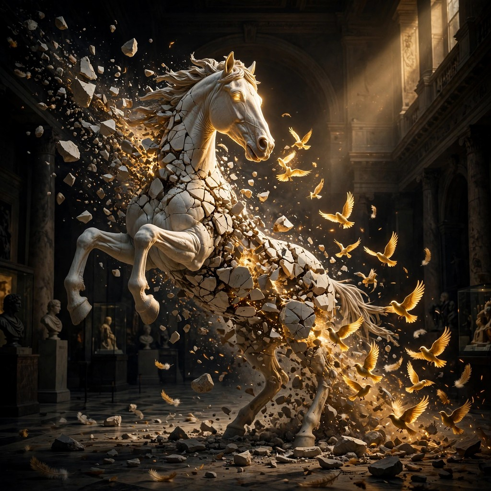

# Stone That Learned to Fly

[](https://make.fun/bounty/ai-excited-01)
[](https://make.fun/bounty/ai-excited-01)
[](https://make.fun/bounty/ai-excited-01)

A marble statue of a rearing horse in a grand museum hall shatters mid-gallop
along a diagonal — and the stone does not fall, it takes wing. Its body breaks
apart into a flock of glowing golden birds, marble shards turning to feathers
and sparks in warm light against deep shadow, the horse's head the one bright
focal point. Stillness becoming flight: the jolt is the moment a thing that
cannot move, moves.



## Run it

```sh
mkdir -p out && MAKEFUN_OUTPUT_DIR=out node main.ts
```

This copies `entry.png` to `out/entry.png` (in the grader, to
`/output/entry.png`). Node 22, standard library only, no dependencies, no
keys, no network.

---

Built for the [ai-excited-01 bounty on make.fun](https://make.fun/bounty/ai-excited-01).
